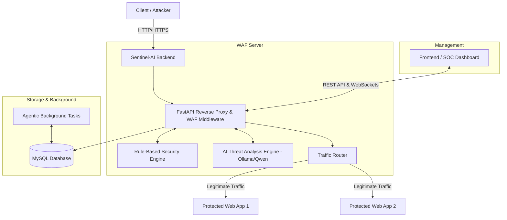
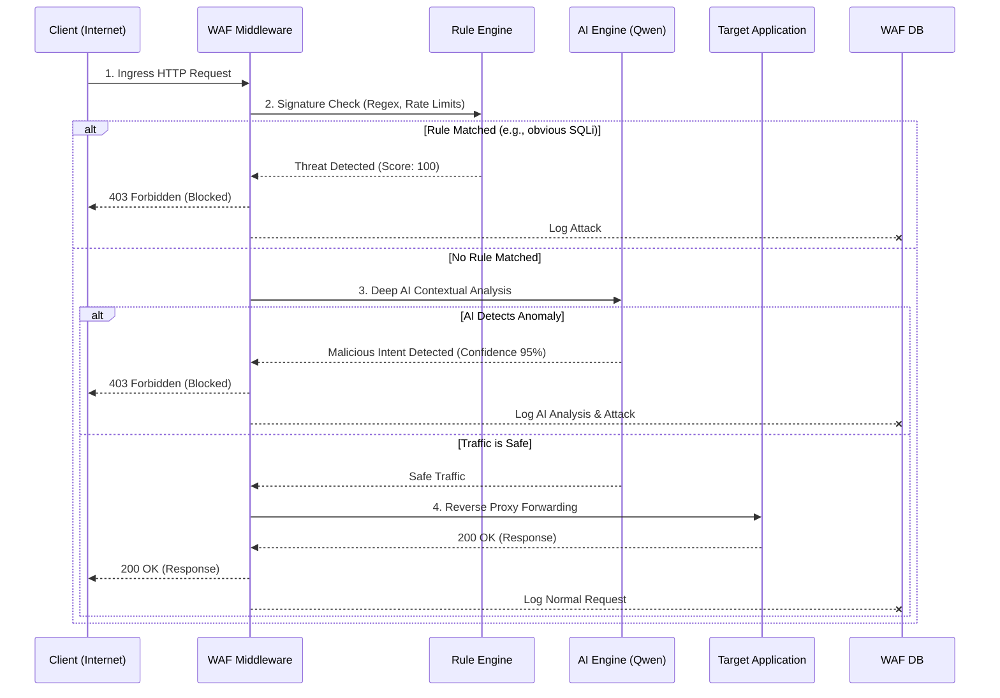
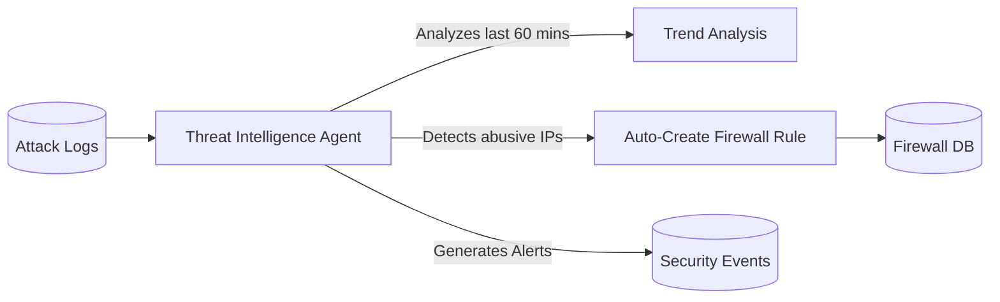

# Sentinel-AI Architecture Document

This document outlines the technical architecture, component breakdown, and request lifecycle of the **Sentinel-AI Web Application Firewall (WAF)**.

## 1. High-Level Architecture

Sentinel-AI is built on a modern, decoupled architecture featuring a React frontend, a high-performance Python (FastAPI) backend, a relational database, and an integrated Local LLM (Large Language Model) for AI-driven threat analysis.

## 2. Component Breakdown

### Frontend (SOC Dashboard)
- **Framework:** React + Vite + TypeScript.
- **Styling:** Tailwind CSS + Vanilla CSS tokens for a premium, dark-mode aesthetic.
- **Real-Time Updates:** WebSockets connect to the backend to stream live attacks directly into the 3D Attack Globe (`react-globe.gl`) and Live Threat Feed without polling.

### Backend (Core WAF & API)
- **Framework:** FastAPI (Python), chosen for its extreme speed and native asynchronous support, which is critical for a proxy server.
- **WAF Middleware:** Every incoming request passes through a custom middleware layer *before* it reaches any protected application. 
- **WebSocket Broadcaster:** Broadcasts blocked requests and system events instantly to connected frontend dashboards.

### AI & Threat Intelligence Engine
- **Engine:** Ollama running `qwen2.5`.
- **Purpose:** Analyzes the context of payloads (headers, body, query parameters) to detect zero-day exploits and obfuscated attacks that evade traditional regex/signature-based rules.
- **Circuit Breaker:** Built-in failover. If the AI model takes too long to load or times out, the WAF fails-open to the Rule-Based engine to ensure legitimate traffic isn't blocked.

### Storage
- **Database:** MySQL.
- **Data Stored:** Access logs, attack logs (with MITRE mapping), audit logs, firewall rules, and AI analyses.

## 3. The Request Lifecycle (How a Request is Processed)

When a packet arrives from the internet, it must pass through a strict gauntlet before it is allowed to reach your internal web applications.

## 4. Agentic Background Operations

Sentinel-AI doesn't just sit and wait; it actively learns and hardens the system using background tasks powered by APScheduler.

**Key Agentic Behaviors:**
1. **Dynamic IP Banning:** If an IP triggers multiple low-severity alerts in a short time window, the Threat Agent autonomously writes a temporary blocking rule to the firewall database, cutting off the attacker immediately.
2. **Threat Reporting:** Periodically aggregates attack vectors to map emerging threats against the MITRE ATT&CK framework, generating actionable recommendations for the SOC team.
